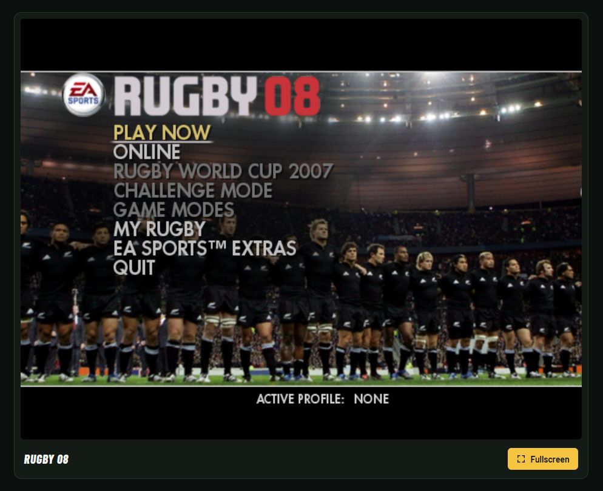

  
  
The 2007 PC rugby game, recompiled to run in the browser, with online play for up to four people.

  
<a href="https://mitchivin.github.io/rugby08/"><strong>mitchivin.github.io/rugby08</strong></a>

## Play

Open [mitchivin.github.io/rugby08](https://mitchivin.github.io/rugby08/) in Chrome or Edge on a desktop computer and press **Play**.

The game downloads about 168 MB on first start. Nothing is installed and no account is needed.

## Play online

1. Press **Play**. When the **Play online** panel appears, pick your region (Australia / Pacific, North America or Europe) and press **Play online**. **Play offline** skips this.
2. You are now hosting a party. Press **Copy invite link** and send it to up to three friends.
3. Each friend opens the link and presses **Play online**. Their game catches up to yours behind the **Joining the party** screen, then they are in.
4. On **Team Select**, each player moves their controller icon to a side. Players on the same side play together.

Every game in the party runs the same simulation in lockstep and the games compare their state as they go, so everyone sees the same match. Players connect to each other directly where they can and through a relay where they can't. If the connection drops, your game carries on offline.

## Controls

A game controller is used when one is connected. Press a button on it once so the browser makes it available. It works from the start screen on: **A** presses **Play**, and on the **Play online** panel the d-pad moves between the region and the buttons, **A** presses the selected button and **B** plays offline.

| Action | Controller |
| :--- | :--- |
| Move, menu navigation | Left stick or d-pad |
| Accept, offload, dive, score try, punt | **A** |
| Pass left / right (hold for a long pass) | **LB** / **RB** |
| Sprint | **RT** |
| Change player | **LT** |
| Grubber kick | **Y** |
| Up and under, call a mark | **X** |
| Drop goal, jump to catch | **B** |
| Sidestep, hand-off, shoulder charge | Right stick |
| Pause | **Start** |

If the controller is unplugged during a match the computer takes over your player until you plug it back in. One controller per browser.

On the keyboard:

| Action | Key |
| :--- | :--- |
| Move, menu navigation | Arrow keys |
| Accept, offload, dive, score try, punt | **S** or **Enter** |
| Pass left / right (hold for a long pass) | **A** / **D** |
| Sprint | **Space** |
| Change player | **Left Shift** |
| Grubber kick | **W** |
| Up and under, call a mark | **Q** |
| Drop goal, jump to catch | **E** |
| Sidestep, hand-off, shoulder charge | Numpad **4 / 6 / 8 / 2** |
| Pause | **Esc** |
| Start | **Left Ctrl** |

Hold a kick key to build power and steer with the arrows. In scrums, rucks, mauls and line-outs the same keys take on the set-piece actions shown on screen.

## Requirements

- A current version of Chrome or Edge. Other browsers are not tested.
- WebGL 2 and WebAssembly support.
- A keyboard or a game controller.

## How it works

- **Recompiled game.** The original Windows executable is translated to C ahead of time and compiled to WebAssembly. A small runtime provides the parts of Windows, Direct3D 8, DirectInput and DirectSound the game expects.
- **Renderer.** Direct3D calls are translated to WebGL 2. Rendering runs on its own thread through an offscreen canvas.
- **Game data.** Game files are stored as compressed chunks on Cloudflare R2, fetched as needed and unpacked in a background worker.
- **Online.** A Cloudflare Worker runs the parties: it issues short-lived tickets, relays inputs and connection setup between players, and keeps the match history so late joiners can catch up. Players exchange inputs over WebRTC, with TURN for networks that block direct connections.

## Repository

This repository holds the project page, artwork and the GitHub Pages deployment. The source and build pipeline are kept privately.
