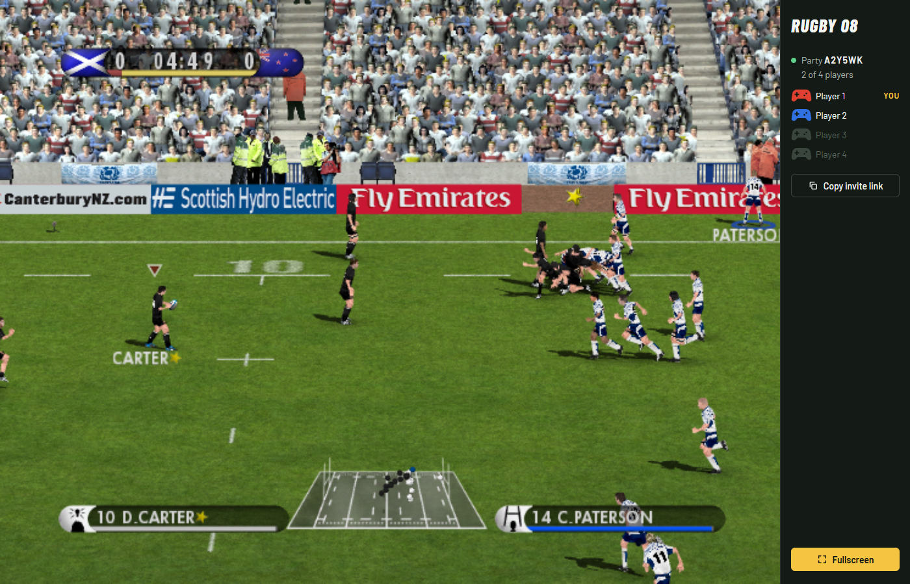

# Rugby 08 in the browser

Play Rugby 08, the 2007 PC rugby game, in your browser. The original Windows game is recompiled to WebAssembly, with online play for up to four people.

**[Play now at mitchivin.github.io/rugby08](https://mitchivin.github.io/rugby08/)**

## Features

- **The full game in a browser tab.** Menus, Play Now matches, My Rugby, intro videos, crowd and commentary audio.
- **No emulator.** The game's own code runs as WebAssembly. There's no Wine, DOSBox or virtual machine.
- **Online multiplayer.** Up to four players in a party, joined by an invite link, on the same team or against each other.
- **60 fps.** Frames are paced with `requestAnimationFrame`, and rendering runs on its own thread.
- **Controller and keyboard.** Xbox-style controllers work from the start screen, and every action has a keyboard key.
- **Installable app.** Chrome and Edge can install it to the desktop and launch it full screen.
- **Nothing to install or sign up for.** About 1 GB downloads on first start, and later starts are much faster.

## Controls

A game controller is used when one is connected. Press a button on it once so the browser makes it available. It works from the start screen on: **A** presses **Play**, and on the **Play online** panel the d-pad moves between the region and the buttons, **A** presses the selected button and **B** plays offline.

| Action | Controller |
| :--- | :--- |
| Move, menu navigation | Left stick or d-pad |
| Accept, offload, dive, score try, punt | **A** |
| Pass left / right (hold for a long pass) | **LB** / **RB** |
| Sprint | **RT** |
| Change player | **LT** |
| Grubber kick | **Y** |
| Up and under, call a mark | **X** |
| Drop goal, jump to catch | **B** |
| Sidestep, hand-off, shoulder charge | Right stick |
| Pause | **Start** |

If the controller is unplugged during a match the computer takes over your player until you plug it back in. One controller per browser.

On the keyboard:

| Action | Key |
| :--- | :--- |
| Move, menu navigation | Arrow keys |
| Accept, offload, dive, score try, punt | **S** or **Enter** |
| Pass left / right (hold for a long pass) | **A** / **D** |
| Sprint | **Space** |
| Change player | **Left Shift** |
| Grubber kick | **W** |
| Up and under, call a mark | **Q** |
| Drop goal, jump to catch | **E** |
| Sidestep, hand-off, shoulder charge | Numpad **4 / 6 / 8 / 2** |
| Pause | **Esc** |
| Start | **Left Ctrl** |

Hold a kick key to build power and steer with the arrows. In scrums, rucks, mauls and line-outs the same keys take on the set-piece actions shown on screen.

## Get started

### Play

Open [mitchivin.github.io/rugby08](https://mitchivin.github.io/rugby08/) in Chrome or Edge on a desktop computer and press **Play**.

The game downloads about 1 GB on first start, then the rest while you play. Later starts are much faster. Nothing is installed and no account is needed.

### Play online

1. Press **Play**. When the **Play online** panel appears, pick your region (Australia / Pacific, North America or Europe) and press **Play online**. **Play offline** skips this.
2. You are now hosting a party. Press **Copy invite link** and send it to up to three friends.
3. Each friend opens the link and presses **Play online**. Their game catches up to yours behind the **Joining the party** screen, then they are in.
4. On **Team Select**, each player moves their controller icon to a side. Players on the same side play together.

Every game in the party runs the same simulation in lockstep and the games compare their state as they go, so everyone sees the same match. Players connect to each other directly where they can and through a relay where they can't. If the connection drops, your game carries on offline.

### Requirements

- A current version of Chrome or Edge. Other browsers are not tested.
- WebGL 2 and WebAssembly support.
- A keyboard or a game controller.

This repository contains the project page and the site deployment. The source is not published here.

## Related

- [DoodleDev](https://github.com/mitchivin/doodledev)
- [Game Boy Color](https://github.com/mitchivin/game-boy-color)
- [iPod Classic](https://github.com/mitchivin/ipod-classic)
- [iPod Original](https://github.com/mitchivin/ipod-original)
- [OP-XY](https://github.com/mitchivin/te-opxy)
- [OP-1 Field](https://github.com/mitchivin/te-op1-field)
- [Frostbolt Player](https://github.com/mitchivin/frostbolt-player)
- [MitchIvin XP](https://mitchivin.com/)

## About

Built by [Mitch Ivin](https://mitchivin.com/).

Rugby 08 in the browser is an independent project and is not affiliated with EA.
